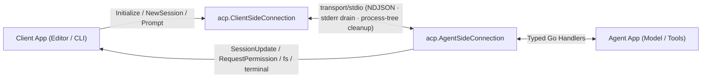

**English** | [简体中文](README.zh-CN.md)

# ACP Go SDK

[](https://pkg.go.dev/github.com/caelis-labs/acp-go-sdk)
[](https://github.com/caelis-labs/acp-go-sdk/releases)
[](go.mod)
[](#protocol-provenance-and-upstream-tracking)
[](#protocol-provenance-and-upstream-tracking)
[](#official-sdk-interoperability)
[](#official-sdk-interoperability)
[](https://github.com/caelis-labs/acp-go-sdk/actions/workflows/upstream-drift.yml)
[](https://github.com/caelis-labs/acp-go-sdk/actions/workflows/ci.yml)
[](LICENSE)

**Build production-grade [Agent Client Protocol (ACP)](https://agentclientprotocol.com) agents and clients in Go.**
Connect your agent to ACP-compatible editors and CLIs, or embed ACP agent support into your own application with typed Go APIs, bounded concurrency, and cross-platform `stdio` subprocess management.

Maintained by Caelis Labs and listed in [ACP's community libraries](https://agentclientprotocol.com/libraries/community#go).
Use it independently of Caelis or any particular agent framework.

[Install](#install) · [Quick start](#quick-start) · [Upstream tracking](#protocol-provenance-and-upstream-tracking) · [Official SDK interop](#official-sdk-interoperability) · [API reference](https://pkg.go.dev/github.com/caelis-labs/acp-go-sdk) · [简体中文](README.zh-CN.md)

## Why `caelis-labs/acp-go-sdk`?

- **Stable `v1` module with minimal dependencies:** The root `acp` package ships a stable `v1` API for ACP wire protocol `1` with only a single module dependency ([`golang.org/x/sys`](go.mod)). `schema.unstable.json` and draft `experimental/v2` are strictly isolated from the root package.
- **Timely official protocol alignment & automated upstream tracking:** Types and dispatchers are deterministically generated from pinned official schemas in [`schema/lock.json`](schema/lock.json) (SHA256-verified). A daily GitHub Action ([`upstream-drift.yml`](.github/workflows/upstream-drift.yml)) checks upstream `schema-v1*`, `schema-v2*`, TypeScript SDK, and Rust SDK releases and opens an `upstream-drift` issue automatically whenever any pin falls behind; `make verify-upstream` enforces lock-to-doc consistency in CI.
- **Release-gated official TypeScript & Rust SDK interoperability:** Every release must pass a live **99-case** conformance gate across **both** ACP wire profiles (`v1` and `v2`) against the pinned official TypeScript and Rust SDK peers tracked in [`upstream/lock.json`](upstream/lock.json), with machine-readable evidence artifacts.
- **Bounded concurrency & deterministic cancellation:** Production defaults cap frame sizes (`10 MiB`), pending requests (`1024`), handler concurrency (`32`), and ordered notification buffers (`1024` items / `32 MiB`), alongside lossless string/number request IDs, `$/cancel_request`, and JSON-RPC `-32800` cancellation.
- **Hardened `stdio` subprocess governance:** Launches executables directly (never via an implicit shell), drains child `stderr`, duplicates process `stdin`/`stdout` independently, and supports graceful `Shutdown(ctx)` with Unix process-group and Windows kill-on-close Job Object cleanup (without console popups).



## Install

Requires **Go 1.23 or later**.

<!-- x-release-please-start-version -->
```bash
go get github.com/caelis-labs/acp-go-sdk@v1.9.1
```
<!-- x-release-please-end -->

Import the root package as `acp`:

```go
import acp "github.com/caelis-labs/acp-go-sdk"
```

The Go module release, pinned official schema tag (exposed at runtime via `acp.SchemaTag`), and negotiated wire protocol version (`acp.WireProtocolVersion`) are tracked as separate identities.

## Quick start

### 1. Build an agent

Implement the four baseline methods on `acp.Agent` (`Initialize`, `NewSession`, `Prompt`, `Cancel`) and serve over `stdio`. Application logs belong on `stderr`; `stdout` is reserved exclusively for ACP NDJSON frames. See [`example/minimal-agent/main.go`](example/minimal-agent/main.go) for the full runnable file.

```go
package main

import (
	"context"
	"errors"
	"log"

	acp "github.com/caelis-labs/acp-go-sdk"
	"github.com/caelis-labs/acp-go-sdk/transport/stdio"
)

type myAgent struct{}

func (*myAgent) Initialize(context.Context, acp.InitializeRequest) (acp.InitializeResponse, error) {
	return acp.InitializeResponse{
		AgentInfo:       &acp.Implementation{Name: "my-acp-agent", Version: "0.1.0"},
		ProtocolVersion: acp.ProtocolVersion(acp.WireProtocolVersion),
	}, nil
}

func (*myAgent) NewSession(context.Context, acp.NewSessionRequest) (acp.NewSessionResponse, error) {
	return acp.NewSessionResponse{SessionId: acp.SessionId("session-1")}, nil
}

func (*myAgent) Prompt(ctx context.Context, params acp.PromptRequest) (acp.PromptResponse, error) {
	conn, ok := acp.AgentSideConnectionFromContext(ctx)
	if !ok {
		return acp.PromptResponse{}, errors.New("missing agent connection in context")
	}
	if err := conn.SessionUpdate(ctx, acp.SessionNotification{
		SessionId: params.SessionId,
		Update:    acp.UpdateAgentMessageText("Hello from Go ACP!"),
	}); err != nil {
		return acp.PromptResponse{}, err
	}
	return acp.PromptResponse{StopReason: acp.StopReasonEndTurn}, nil
}

func (*myAgent) Cancel(context.Context, acp.CancelNotification) error { return nil }

func main() {
	if err := stdio.ServeAgent(context.Background(), &myAgent{}, acp.ConnectionOptions{}); err != nil &&
		!errors.Is(err, acp.ErrPeerClosed) {
		log.Fatal(err)
	}
}
```

### 2. Build a client

Implement `acp.Client` (`RequestPermission`, `SessionUpdate`), launch the agent executable via `stdio.StartClient`, negotiate `Initialize`, and stream session updates. See [`example/client/main.go`](example/client/main.go) for the complete runnable client.

```go
proc, err := stdio.StartClient(ctx, myClient{}, stdio.Command{
	Executable: agentPath,
	Args:       agentArgs,
}, acp.ConnectionOptions{})
if err != nil {
	return err
}
defer func() {
	shutdownCtx, cancel := context.WithTimeout(context.Background(), 5*time.Second)
	defer cancel()
	err = errors.Join(err, proc.Shutdown(shutdownCtx))
}()

initResp, err := proc.Connection.Initialize(ctx, acp.InitializeRequest{
	ProtocolVersion: acp.ProtocolVersion(acp.WireProtocolVersion),
	ClientInfo:      &acp.Implementation{Name: "my-go-client", Version: "0.1.0"},
})
if err != nil {
	return err
}
if initResp.ProtocolVersion != acp.ProtocolVersion(acp.WireProtocolVersion) {
	return fmt.Errorf("unsupported ACP protocol version %d", initResp.ProtocolVersion)
}

sess, err := proc.Connection.NewSession(ctx, acp.NewSessionRequest{
	Cwd:        cwd,
	McpServers: []acp.McpServer{},
})
if err != nil {
	return err
}
resp, err := proc.Connection.Prompt(ctx, acp.PromptRequest{
	SessionId: sess.SessionId,
	Prompt:    []acp.ContentBlock{acp.TextBlock("Hello")},
})
```

### Run an agent and client

Run a complete local conversation with only Go installed—no model account, API key, Node.js, or Rust is needed:

```bash
git clone https://github.com/caelis-labs/acp-go-sdk.git
cd acp-go-sdk
go build -o .artifacts/minimal-agent ./example/minimal-agent
go run ./example/client -agent ./.artifacts/minimal-agent
```

Expected output:

```text
Hello from the minimal Go ACP agent.
Stop reason: end_turn
```

On Windows, build `.artifacts/minimal-agent.exe` and pass that path to `-agent`. To connect the sample client to any external installed ACP agent instead, pass its binary and flags after `--`:

```bash
go run ./example/client -agent /path/to/acp-agent -- --acp
```

| Start here | What it demonstrates |
|---|---|
| [`example/minimal-agent/main.go`](example/minimal-agent/main.go) | Implement `Initialize`, `NewSession`, `Prompt`, and `Cancel`; stream a response over `stdio`. |
| [`example/client/main.go`](example/client/main.go) | Launch an agent, negotiate ACP v1, create a session, send a prompt, print streamed text, and shut down the child tree. |

## Capabilities and interfaces

Optional ACP capabilities are modeled as separate opt-in Go interfaces. Implement an optional interface **and** advertise its capability during `Initialize`; omitted capabilities mean unsupported, and unimplemented inbound methods return JSON-RPC `-32601` (`Method not found`).

| Side | Scope | Interfaces |
|---|---|---|
| **Agent** | Required baseline | `acp.Agent` (`Initialize`, `NewSession`, `Prompt`, `Cancel`) |
| **Agent** | Optional capabilities | `AgentAuthenticator`, `AgentLogout`, `AgentLoader`, `AgentSessionLister`, `AgentSessionResumer`, `AgentSessionConfig`, `AgentSessionMode`, `AgentSessionCloser`, `AgentSessionDeleter` |
| **Client** | Required baseline | `acp.Client` (`RequestPermission`, `SessionUpdate`) |
| **Client** | Optional capabilities | `ClientFileReader`, `ClientFileWriter`, `ClientTerminal`, `ClientElicitation`, `ClientElicitationCompletion` |
| **Both** | Custom `_`-prefixed extensions | `ExtensionMethodHandler` (`CallExtension` / `NotifyExtension` + `_meta` preservation) |

## Protocol provenance and upstream tracking

Official ACP JSON Schema releases are the sole wire source of truth. Every pinned upstream identity—across stable `schema-v1*`, draft `schema-v2*`, and the official TypeScript and Rust SDKs used for interop—is recorded in [`upstream/lock.json`](upstream/lock.json) and kept in sync with documentation via `make sync-upstream-docs` and verified by `make verify-upstream` in CI.

<!-- upstream-pins:en:start -->
| Tracked upstream artifact | Repository | Pinned tag / version | Upstream commit | Verification / lock file |
|---|---|---|---|---|
| **Stable ACP v1 Schema** (wire `1`) | [`agentclientprotocol/agent-client-protocol`](https://github.com/agentclientprotocol/agent-client-protocol) | `schema-v1.35.0` | `065b5795` | [`schema/lock.json`](schema/lock.json) (`schema.json` SHA256 `d3ddaefb...`) |
| **Draft ACP v2 Schema** (`experimental/v2`) | [`agentclientprotocol/agent-client-protocol`](https://github.com/agentclientprotocol/agent-client-protocol) | `schema-v2.0.0-beta.4` | `840484ff` | [`schema/v2/lock.json`](schema/v2/lock.json) (`schema.json` SHA256 `86dae71c...`) |
| **Official TypeScript SDK** | [`agentclientprotocol/typescript-sdk`](https://github.com/agentclientprotocol/typescript-sdk) | `v2.12.0` (`@agentclientprotocol/sdk`) | `6b84c6da` | [`interop/versions.json`](interop/versions.json) |
| **Official Rust SDK** | [`agentclientprotocol/rust-sdk`](https://github.com/agentclientprotocol/rust-sdk) | `v5.6.1` (`agent-client-protocol`, Rust `1.88.0`) | `4656755a` | [`interop/versions.json`](interop/versions.json) |
<!-- upstream-pins:en:end -->

### Automated upstream drift tracking & alignment SLA

- **Daily automated drift detection:** [`.github/workflows/upstream-drift.yml`](.github/workflows/upstream-drift.yml) runs `go run ./cmd/upstreamdrift -remote` ([`scripts/upstream-drift.sh`](scripts/upstream-drift.sh)) every day against GitHub releases/tags and automatically opens or updates an `upstream-drift` issue whenever any schema or official SDK pin falls behind.
- **Fast alignment policy ([`upstream/README.md`](upstream/README.md)):**
  - **Stable `schema-v1*`:** locked, regenerated, compatibility-reviewed, and interop-verified within one week of an upstream release.
  - **Official TypeScript & Rust SDKs:** every formal upstream SDK release bumps the interop pin and re-runs the four-direction matrix—even when the wire schema itself is unchanged.
  - **Draft `schema-v2*`:** tracks tagged `schema-v2*` snapshots in isolated `experimental/v2` without chasing unpinned commits on upstream `main` or polluting the stable root package.

### Package surface and scope

| Package | Stability contract |
|---|---|
| Root `acp` | **Stable ACP wire v1.** Generated types (`schema/schema.json` only), Agent/Client dispatch, and bounded concurrent bidirectional JSON-RPC. |
| `transport/stdio` | **Stable NDJSON transport.** Direct executable launch, `stderr` draining, independent descriptor duplication, and owned process-tree lifecycle. |
| `experimental/v2` | **Unstable draft API.** Generated from the pinned `schema-v2*` snapshot; may change incompatibly. Do not import from stable code. See [docs/experimental-v2.md](docs/experimental-v2.md). |

Applications retain full ownership of model execution, persistence, authorization policy, and sandboxed filesystem/terminal implementations. HTTP/SSE and WebSocket draft transports are outside the stable contract. See the [latest alignment notes (2026-11-24)](docs/schema-sdk-alignment-2026-11-24.md), [versioned interop notes](docs/versioned-interop-2026-11-13.md), and migration guides ([v1.5.0](docs/upgrading-to-v1.5.0.md), [v1.4.0](docs/upgrading-to-v1.4.0.md)).

## Official SDK interoperability

The repository includes a deterministic four-direction interoperability harness against the pinned official TypeScript and Rust SDKs tracked in [`interop/versions.json`](interop/versions.json) and [`upstream/lock.json`](upstream/lock.json). A Go runner owns process lifecycles, timeouts, and assertions, while the TypeScript and Rust peers act as thin public-API adapters over real `stdio` pipes.

| Suite | Profile | Directions / scope | Cases |
|---|---|---|---|
| Core conversation, permission, notices/compaction, plans/subagents, empty params, `session/cancel`, `$/cancel_request` | `v1` | Four directions (`Go ↔ TS`, `Go ↔ Rust`) × 3 scenarios | 12 |
| `SystemPrompt` lifecycle & capability contracts | `v1` | Four directions × 4 capability profiles | 16 |
| Boolean & string-ID configuration writes | `v1` | Four directions | 4 |
| Draft `v2` contract suite (`SystemPrompt`, omitted/null capabilities, full lifecycle/auth/config/reverse/states/cancellation, post-response user-message updates, version negotiation, content rejection) | `v2` | Four directions | 40 |
| Invalid-envelope & unsupported-method receiver wire probes | `v2` | Go, TypeScript, and Rust agents × 7 probes | 21 |
| Opt-in MCP-over-ACP attribution, admission & pre-forward cancellation | `v1` & `v2` unstable | Two SDK providers + TypeScript bridge per profile | 6 |
| **Total** | | | **99** |

To run the full interop suite locally (requires **Node.js 24** and the Rust toolchain pinned in [`interop/peers/rust/rust-toolchain.toml`](interop/peers/rust/rust-toolchain.toml)):

```bash
make interop
```

CI uploads all four machine-readable evidence reports (`evidence.json`, `contract-evidence.json`, `wire-v2-evidence.json`, and `mcp-experimental-evidence.json`) under `.artifacts/interop/`. See [`interop/README.md`](interop/README.md) for the complete case inventory and verification boundaries.

## Production guarantees and advanced usage

Pass `acp.ConnectionOptions{}` to select production bounds (`acp.DefaultConnectionOptions()`):

| `ConnectionOptions` field | Default | Bounds |
|---|---|---|
| `MaxFrameSize` | `10 MiB` | Single NDJSON frame size |
| `MaxPendingRequests` | `1024` | Concurrent outbound in-flight requests |
| `MaxHandlerConcurrency` | `32` | Concurrent inbound request handlers |
| `MaxQueuedRequests` | `128` | Queued inbound requests awaiting dispatch |
| `MaxQueuedNotifications` | `1024` | Buffered inbound notifications |
| `MaxNotificationBytes` | `32 MiB` | Bytes across queued + executing notifications |
| `MaxQueuedWrites` | `1024` | Queued outbound frames |

Deep-dive reference guides:

- **[Connection bounds, lifecycle, and advanced helpers](docs/advanced.md):** `AcceptNotification` and `AcceptRequestID` admission filters, `stdio.DuplicateFile` and `Process.Shutdown(ctx)` cross-platform process-tree cleanup, lossless request IDs and NDJSON batch framing (`SendTransportFrame`, `RejectBatch`), `*acp.RequestError` / `*acp.TransportError`, inbound context helpers (`InboundInfoFromContext`, `InboundParamsFromContext`, `AgentSideConnectionFromContext`, `AfterResponse`, `NewSessionWithResponseHook`), tri-state patch fields, stable `SystemPrompt` capability rules, and `SessionUpdateRaw`.
- **[Prepared request lifecycle](docs/prepared-requests.md):** `PrepareClientRequest` / `PrepareAgentRequest` for separated dispatch and wait contexts, `ObserveResponse` ordering barriers, and conservative `RequestSubmissionNotStarted` retry classification.
- **[Draft ACP v2 (`experimental/v2`)](docs/experimental-v2.md):** Isolated draft v2 schema details (`messageId`, `AvailableCommands`, tri-state tool-call `name`), interop gate coverage, and alignment notes.

## Development, validation, and releases

Run schema, lock, code-generation, race, and static checks locally:

```bash
make check          # verify-schema + verify-upstream + check-generated + test + vet + gofmt + git diff --check
make test-race      # race detector across root and cmd/generate
make sync-upstream-docs  # sync marked upstream pin tables in README / docs from lock files
go test -run=^$ -fuzz=FuzzRequestID -fuzztime=30s
```

Generated files carry `DO NOT EDIT` headers; `cmd/generate` is isolated as its own module, and `make check-generated` verifies zero drift between schemas and checked-in Go code. Fuzz seed corpora for JSON messages, request IDs, unions, and framing replay automatically during `go test ./...`.

Release Please maintains release PRs, while publication verifies that the merged Git tree matches the complete CI matrix—including `-race`, native Windows `stdio`, fresh-consumer module builds, API diff checks, and official SDK interop. See [`.github/workflows/ci.yml`](.github/workflows/ci.yml), [`RELEASING.md`](RELEASING.md), [`CHANGELOG.md`](CHANGELOG.md), and [`SECURITY.md`](SECURITY.md).

## Attribution and license

Licensed under the **Apache License 2.0** (see [`LICENSE`](LICENSE) and [`NOTICE`](NOTICE)).

The implementation derives its generator and connection baseline from [`coder/acp-go-sdk`](https://github.com/coder/acp-go-sdk), and evolves independently to track pinned official schemas with strict bounds, lifecycle guarantees, and cross-SDK conformance gates.
