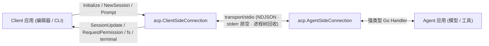

[English](README.md) | **简体中文**

# ACP Go SDK

[](https://pkg.go.dev/github.com/caelis-labs/acp-go-sdk)
[](https://github.com/caelis-labs/acp-go-sdk/releases)
[](go.mod)
[](#protocol-provenance-and-upstream-tracking)
[](#protocol-provenance-and-upstream-tracking)
[](#official-sdk-interoperability)
[](#official-sdk-interoperability)
[](https://github.com/caelis-labs/acp-go-sdk/actions/workflows/upstream-drift.yml)
[](https://github.com/caelis-labs/acp-go-sdk/actions/workflows/ci.yml)
[](LICENSE)

**使用 Go 构建生产级 [Agent Client Protocol (ACP)](https://agentclientprotocol.com) Agent 与 Client。**
通过强类型 Go API、有界并发控制与跨平台 `stdio` 子进程生命周期管理，将你的 Agent 接入支持 ACP 的编辑器与终端，或在自己的 Go 应用中集成 ACP Agent 能力。

由 Caelis Labs 维护，已收录于 [ACP 官方社区库列表](https://agentclientprotocol.com/libraries/community#go)。
纯协议层设计，不绑定 Caelis 或任何特定 Agent 框架，可独立使用。

[安装](#install) · [快速开始](#quick-start) · [上游跟踪与协议溯源](#protocol-provenance-and-upstream-tracking) · [官方 SDK 互操作](#official-sdk-interoperability) · [API 文档](https://pkg.go.dev/github.com/caelis-labs/acp-go-sdk) · [English](README.md)

## 为什么选择 `caelis-labs/acp-go-sdk`？

- **稳定的 `v1` 契约与极简依赖：** 根包 `acp` 为 ACP 线协议 `1` 提供稳定的 `v1` API，整个模块仅有一个外部依赖（[`golang.org/x/sys`](go.mod)）。`schema.unstable.json` 与草案 `experimental/v2` 与稳定根包严格隔离。
- **紧跟官方协议与全自动上游漂移追踪：** 类型与分发器由 [`schema/lock.json`](schema/lock.json) 中固定的官方 Schema 确定性生成并通过 SHA256 校验。每日定时 GitHub Action（[`upstream-drift.yml`](.github/workflows/upstream-drift.yml)）会自动巡检官方 `schema-v1*`、`schema-v2*` 以及官方 TypeScript / Rust SDK 新版本，一旦落后立即自动创建或更新 `upstream-drift` Issue；`make verify-upstream` 在 CI 中强制校验文档与锁文件零漂移。
- **发版门禁级官方 TypeScript / Rust 互操作验证：** 每次发版前必须通过覆盖 **v1 与 v2 双协议版本**、共 **99 个测试用例**的真实进程互操作门禁，对标 [`upstream/lock.json`](upstream/lock.json) 中固定并持续跟踪的官方 TypeScript 与 Rust SDK，并产出可审计的机器可读证据报告。
- **生产级有界并发与背压控制：** 对帧大小（`10 MiB`）、在途请求数（`1024`）、并发处理器（`32`）和有序通知队列（`1024` 条 / `32 MiB`）提供默认上限；支持无精度损失的字符串/数字请求 ID、`$/cancel_request` 以及 JSON-RPC `-32800` 取消语义。
- **可靠的跨平台 `stdio` 子进程治理：** 直接启动可执行文件（绝不经过隐式 shell），持续排空子进程 `stderr` 防止管道阻塞，独立复制进程 `stdin`/`stdout` 句柄；提供幂等 `Close` 与优雅 `Shutdown(ctx)`，支持 Unix 进程组与 Windows kill-on-close Job Object 进程树回收（且无控制台弹窗）。



<a id="install"></a>
## 安装

需要 **Go 1.23 或更高版本**。

<!-- x-release-please-start-version -->
```bash
go get github.com/caelis-labs/acp-go-sdk@v1.9.1
```
<!-- x-release-please-end -->

以 `acp` 别名导入根包：

```go
import acp "github.com/caelis-labs/acp-go-sdk"
```

Go 模块发布版本、固定的官方 Schema 标签（运行时可通过 `acp.SchemaTag` 获取）以及协商的线协议版本（`acp.WireProtocolVersion`）是相互独立的版本标识。

<a id="quick-start"></a>
## 快速开始

### 1. 构建 Agent

实现 `acp.Agent` 的四个核心方法（`Initialize`、`NewSession`、`Prompt`、`Cancel`）并通过 `stdio.ServeAgent` 启动服务。应用日志请输出到 `stderr`，`stdout` 仅用于传输 ACP NDJSON 协议帧。完整可运行代码见 [`example/minimal-agent/main.go`](example/minimal-agent/main.go)。

```go
package main

import (
	"context"
	"errors"
	"log"

	acp "github.com/caelis-labs/acp-go-sdk"
	"github.com/caelis-labs/acp-go-sdk/transport/stdio"
)

type myAgent struct{}

func (*myAgent) Initialize(context.Context, acp.InitializeRequest) (acp.InitializeResponse, error) {
	return acp.InitializeResponse{
		AgentInfo:       &acp.Implementation{Name: "my-acp-agent", Version: "0.1.0"},
		ProtocolVersion: acp.ProtocolVersion(acp.WireProtocolVersion),
	}, nil
}

func (*myAgent) NewSession(context.Context, acp.NewSessionRequest) (acp.NewSessionResponse, error) {
	return acp.NewSessionResponse{SessionId: acp.SessionId("session-1")}, nil
}

func (*myAgent) Prompt(ctx context.Context, params acp.PromptRequest) (acp.PromptResponse, error) {
	conn, ok := acp.AgentSideConnectionFromContext(ctx)
	if !ok {
		return acp.PromptResponse{}, errors.New("missing agent connection in context")
	}
	if err := conn.SessionUpdate(ctx, acp.SessionNotification{
		SessionId: params.SessionId,
		Update:    acp.UpdateAgentMessageText("Hello from Go ACP!"),
	}); err != nil {
		return acp.PromptResponse{}, err
	}
	return acp.PromptResponse{StopReason: acp.StopReasonEndTurn}, nil
}

func (*myAgent) Cancel(context.Context, acp.CancelNotification) error { return nil }

func main() {
	if err := stdio.ServeAgent(context.Background(), &myAgent{}, acp.ConnectionOptions{}); err != nil &&
		!errors.Is(err, acp.ErrPeerClosed) {
		log.Fatal(err)
	}
}
```

### 2. 构建 Client

实现 `acp.Client`（`RequestPermission`、`SessionUpdate`），通过 `stdio.StartClient` 拉起 Agent 子进程并依次调用 `Initialize`、`NewSession` 和 `Prompt`。完整示例见 [`example/client/main.go`](example/client/main.go)。

```go
func runClient(ctx context.Context, agentPath string, agentArgs []string, cwd string) (err error) {
	proc, err := stdio.StartClient(ctx, myClient{}, stdio.Command{
		Executable: agentPath,
		Args:       agentArgs,
	}, acp.ConnectionOptions{})
	if err != nil {
		return err
	}
	defer func() {
		shutdownCtx, cancel := context.WithTimeout(context.Background(), 5*time.Second)
		defer cancel()
		err = errors.Join(err, proc.Shutdown(shutdownCtx))
	}()

	initResp, err := proc.Connection.Initialize(ctx, acp.InitializeRequest{
		ProtocolVersion: acp.ProtocolVersion(acp.WireProtocolVersion),
		ClientInfo:      &acp.Implementation{Name: "my-go-client", Version: "0.1.0"},
	})
	if err != nil {
		return err
	}
	if initResp.ProtocolVersion != acp.ProtocolVersion(acp.WireProtocolVersion) {
		return fmt.Errorf("unsupported ACP protocol version %d", initResp.ProtocolVersion)
	}

	sess, err := proc.Connection.NewSession(ctx, acp.NewSessionRequest{
		Cwd:        cwd,
		McpServers: []acp.McpServer{},
	})
	if err != nil {
		return err
	}
	resp, err := proc.Connection.Prompt(ctx, acp.PromptRequest{
		SessionId: sess.SessionId,
		Prompt:    []acp.ContentBlock{acp.TextBlock("Hello")},
	})
	if err != nil {
		return err
	}
	fmt.Printf("\nStop reason: %s\n", resp.StopReason)
	return nil
}
```

<a id="run-an-agent-and-client"></a>
### 本地跑通完整 Agent 与 Client 对话

只需安装 Go，无需任何模型账号、API Key、Node.js 或 Rust，即可在本地跑通完整对话：

```bash
git clone https://github.com/caelis-labs/acp-go-sdk.git
cd acp-go-sdk
go build -o .artifacts/minimal-agent ./example/minimal-agent
go run ./example/client -agent ./.artifacts/minimal-agent
```

预期输出：

```text
Hello from the minimal Go ACP agent.
Stop reason: end_turn
```

Windows 下请编译为 `.artifacts/minimal-agent.exe` 并传给 `-agent`。如需将该示例 Client 连接到任意其他已安装的 ACP Agent，只需在 `--` 后附带目标 Agent 的启动参数：

```bash
go run ./example/client -agent /path/to/acp-agent -- --acp
```

| 示例入口 | 演示内容 |
|---|---|
| [`example/minimal-agent/main.go`](example/minimal-agent/main.go) | 实现 `Initialize`、`NewSession`、`Prompt` 与 `Cancel`，通过 `stdio` 流式返回消息。 |
| [`example/client/main.go`](example/client/main.go) | 启动 Agent 子进程、协商 ACP v1、创建会话、发送 Prompt、打印流式响应并回收子进程树。 |

## 协议能力与接口总览

可选的 ACP 能力以独立 Go 接口拆分定义。实现对应可选接口**并**按协议要求在 `Initialize` 能力或会话响应中声明后才会启用；未声明的能力视为不支持，未实现的入站请求会返回 JSON-RPC `-32601`（`Method not found`）。

| 角色 | 范围 | 接口 |
|---|---|---|
| **Agent** | 必选核心接口 | `acp.Agent`（`Initialize`、`NewSession`、`Prompt`、`Cancel`） |
| **Agent** | 可选能力接口 | `AgentAuthenticator`、`AgentLogout`、`AgentLoader`、`AgentSessionLister`、`AgentSessionResumer`、`AgentSessionConfig`、`AgentSessionMode`、`AgentSessionCloser`、`AgentSessionDeleter` |
| **Client** | 必选核心接口 | `acp.Client`（`RequestPermission`、`SessionUpdate`） |
| **Client** | 可选能力接口 | `ClientFileReader`、`ClientFileWriter`、`ClientTerminal`、`ClientElicitation`、`ClientElicitationCompletion` |
| **双向** | `_` 前缀扩展方法 | `ExtensionMethodHandler`（`HandleExtensionMethod`）；连接出站方法 `CallExtension` / `NotifyExtension`；协议类型保留 `_meta` |

<a id="protocol-provenance-and-upstream-tracking"></a>
## 协议溯源与上游自动追踪

官方发布的 ACP JSON Schema 是唯一的线协议权威来源。本仓库将所追踪的官方上游版本——包括稳定版 `schema-v1*`、草案 `schema-v2*` 以及用于互操作测试的官方 TypeScript / Rust SDK——统一锁定在 [`upstream/lock.json`](upstream/lock.json) 中；文档中的版本表由 `make sync-upstream-docs` 自动同步，并由 `make verify-upstream` 在 CI 中校验零漂移。

<!-- upstream-pins:zh-CN:start -->
| 追踪的上游组件 | 上游仓库 | 当前固定版本 (Pin) | 上游 Commit | 校验 / 锁定文件 |
|---|---|---|---|---|
| **ACP v1 稳定 Schema**（线协议 `1`） | [`agentclientprotocol/agent-client-protocol`](https://github.com/agentclientprotocol/agent-client-protocol) | `schema-v1.35.0` | `065b5795` | [`schema/lock.json`](schema/lock.json)（`schema.json` SHA256 `d3ddaefb...`） |
| **ACP v2 草案 Schema**（`experimental/v2`） | [`agentclientprotocol/agent-client-protocol`](https://github.com/agentclientprotocol/agent-client-protocol) | `schema-v2.0.0-beta.4` | `840484ff` | [`schema/v2/lock.json`](schema/v2/lock.json)（`schema.json` SHA256 `86dae71c...`） |
| **官方 TypeScript SDK** | [`agentclientprotocol/typescript-sdk`](https://github.com/agentclientprotocol/typescript-sdk) | `v2.12.0`（`@agentclientprotocol/sdk`） | `6b84c6da` | [`interop/versions.json`](interop/versions.json) |
| **官方 Rust SDK** | [`agentclientprotocol/rust-sdk`](https://github.com/agentclientprotocol/rust-sdk) | `v5.6.1`（`agent-client-protocol`，Rust `1.88.0`） | `4656755a` | [`interop/versions.json`](interop/versions.json) |
<!-- upstream-pins:zh-CN:end -->

### 上游漂移自动巡检与跟进策略

- **每日自动巡检：** [`.github/workflows/upstream-drift.yml`](.github/workflows/upstream-drift.yml) 每日定时执行 `go run ./cmd/upstreamdrift -remote`（[`scripts/upstream-drift.sh`](scripts/upstream-drift.sh)），比对 GitHub 官方 Tag 与 Release；一旦发现 Schema 或官方 TS/Rust SDK 出现更新，自动创建或更新 `upstream-drift` Issue 提醒跟进。
- **及时对齐策略（[`upstream/README.md`](upstream/README.md)）：**
  - **稳定版 `schema-v1*`：** 官方发布后 1 周内完成锁版本、重新生成代码、兼容性审查及跨语言互操作验证。
  - **官方 TypeScript / Rust SDK：** 每次官方 SDK 正式发版，即使线协议 Schema 本身未变，也会同步升级互操作 Pin 并重跑四向测试矩阵。
  - **草案 `schema-v2*`：** 仅跟踪带 Tag 的 `schema-v2*` 发布快照，隔离在 `experimental/v2` 中演进，不追逐上游 `main` 的未固定提交，也不污染稳定根包。

### 包边界与适用范围

| 包路径 | 契约范围 |
|---|---|
| 根包 `acp` | **ACP 线协议 v1 稳定版。** 仅基于 `schema/schema.json` 生成类型、Agent/Client 分发器及有界双向 JSON-RPC 连接。 |
| `transport/stdio` | **稳定 NDJSON 传输层。** 直接进程启动、`stderr` 排空、独立描述符复制与跨平台进程树生命周期控制。 |
| `experimental/v2` | **不稳定草案 API。** 基于固定的 `schema-v2*` 快照生成，可能发生不兼容变更；请勿在稳定代码中导入。详见 [`docs/experimental-v2.md`](docs/experimental-v2.md)（英文）。 |

SDK 专注于协议与传输层；模型运行时、持久化存储、权限审批策略以及受控的文件系统/终端实现仍由宿主应用自主掌控。HTTP/SSE 与 WebSocket 草案传输不在稳定契约范围内。最新协议对齐与升级说明见 [`docs/schema-sdk-alignment-2026-11-24.md`](docs/schema-sdk-alignment-2026-11-24.md)、[`docs/versioned-interop-2026-11-13.md`](docs/versioned-interop-2026-11-13.md)、[`docs/upgrading-to-v1.5.0.md`](docs/upgrading-to-v1.5.0.md) 与 [`docs/upgrading-to-v1.4.0.md`](docs/upgrading-to-v1.4.0.md)（英文）。

<a id="official-sdk-interoperability"></a>
## 官方 SDK 跨语言互操作测试

仓库内置了针对官方 TypeScript 与 Rust SDK 的确定性四向互操作测试套件，对应 SDK 版本受 [`interop/versions.json`](interop/versions.json) 与 [`upstream/lock.json`](upstream/lock.json) 锁定与自动跟踪。测试由 Go Runner 统一控制子进程生命周期、超时与断言，TS 和 Rust 端作为薄适配层通过真实 `stdio` 管道交互。

| 测试套件 | 协议版本 | 方向 / 覆盖范围 | 用例数 |
|---|---|---|---|
| 核心对话、权限请求、notices/compaction、plans/subagents、空参数探测、`session/cancel`、`$/cancel_request` | `v1` | 四向（`Go ↔ TS`、`Go ↔ Rust`）× 3 场景 | 12 |
| `SystemPrompt` 生命周期与能力声明契约 | `v1` | 四向 × 4 能力组合 | 16 |
| 布尔与字符串 ID 配置项写入 | `v1` | 四向 | 4 |
| 草案 `v2` 契约套件（`SystemPrompt`、省略/null 能力、完整生命周期/鉴权/配置/反向调用/状态与取消、Prompt 响应后的用户消息更新、版本协商、内容校验拒绝） | `v2` | 四向 × 10 用例 | 40 |
| 非法信封与未支持方法接收端探测 | `v2` | Go、TypeScript 与 Rust Agent × 7 探测 | 21 |
| 可选 MCP-over-ACP 归属、准入与转发前取消探测 | `v1` 与 `v2` unstable | 每协议版本 2 个 SDK Provider + TS 桥接 | 6 |
| **合计** | | | **99** |

在本地运行完整互操作测试（需安装 **Node.js 24** 及 [`interop/peers/rust/rust-toolchain.toml`](interop/peers/rust/rust-toolchain.toml) 指定的 Rust 工具链）：

```bash
make interop
```

CI 会在 `.artifacts/interop/` 下上传四份机器可读证据报告（`evidence.json`、`contract-evidence.json`、`wire-v2-evidence.json` 与 `mcp-experimental-evidence.json`）。完整用例清单与验证边界见 [`interop/README.md`](interop/README.md)（英文）。

## 生产级保证与进阶文档

传入 `acp.ConnectionOptions{}` 即可启用全部默认资源边界（`acp.DefaultConnectionOptions()`）：

| `ConnectionOptions` 字段 | 默认值 | 限制目标 |
|---|---|---|
| `MaxFrameSize` | `10 MiB` | 单条 NDJSON 协议帧最大字节数 |
| `MaxPendingRequests` | `1024` | 并发在途出站请求数 |
| `MaxHandlerConcurrency` | `32` | 并发执行的入站请求处理器数 |
| `MaxQueuedRequests` | `128` | 等待调度的入站请求队列长度 |
| `MaxQueuedNotifications` | `1024` | 排队等待有序分发的入站通知数 |
| `MaxNotificationBytes` | `32 MiB` | 排队中与执行中通知的总负载字节数 |
| `MaxQueuedWrites` | `1024` | 出站写入队列长度 |

进阶机制参考文档（英文）：

- **[连接边界、生命周期与进阶能力](docs/advanced.md):** `AcceptNotification` 与 `AcceptRequestID` 入口过滤、`stdio.DuplicateFile` 与 `Process.Shutdown(ctx)` 跨平台进程树回收、无损请求 ID 与 NDJSON 批处理（`SendTransportFrame`、`RejectBatch`）、`*acp.RequestError` / `*acp.TransportError` 结构化错误、入站 Context 辅助函数（`InboundInfoFromContext`、`InboundParamsFromContext`、`AgentSideConnectionFromContext`、`AfterResponse`、`NewSessionWithResponseHook`）、三态字段、稳定版 `SystemPrompt` 规则与 `SessionUpdateRaw` 透传。
- **[PreparedRequest 生命周期](docs/prepared-requests.md):** 使用 `PrepareClientRequest` / `PrepareAgentRequest` 分离派发与等待 Context、`ObserveResponse` 响应观测屏障，以及基于 `RequestSubmissionNotStarted` 的幂等重试判断。
- **[Draft ACP v2 (`experimental/v2`)](docs/experimental-v2.md):** 隔离版草案 `v2` 协议语义说明（`messageId`、`AvailableCommands` 联合类型、三态工具名称）、互操作门禁范围与对齐历史记录。

## 开发验证与发布机制

本地运行完整 Schema 校验、上游一致性校验、代码生成比对、静态检查与竞态测试：

```bash
make check               # verify-schema + verify-upstream + check-generated + test + vet + gofmt + git diff --check
make test-race           # 在根模块与 cmd/generate 下运行 -race 测试
make sync-upstream-docs  # 从 lock 文件同步更新 README 与文档中的上游版本表
go test -run=^$ -fuzz=FuzzRequestID -fuzztime=30s
```

代码生成器位于独立模块 `cmd/generate`，所有生成文件均带有 `DO NOT EDIT` 标识，`make check-generated` 会重新生成到临时目录并逐文件比对确保零漂移。JSON 消息、请求 ID、联合类型与帧解析的 Fuzz 语料库会在常规 `go test ./...` 中自动回放。

发版由 Release Please 维护版本 PR，发布脚本会校验合入的 Git 树必须与完整 CI（含 `-race`、原生 Windows `stdio`、全新消费者模块构建、API 变更 diff 与官方 SDK 四向互操作测试）完全一致后方才打不可变 Tag 并发布 Release。详情见 [`.github/workflows/ci.yml`](.github/workflows/ci.yml)、[`RELEASING.md`](RELEASING.md)、[`CHANGELOG.md`](CHANGELOG.md) 与 [`SECURITY.md`](SECURITY.md)。

## 致谢与开源协议

本仓库基于 **Apache License 2.0** 协议开源（见 [`LICENSE`](LICENSE) 与 [`NOTICE`](NOTICE)）。

代码生成器与基础连接实现源自 [`coder/acp-go-sdk`](https://github.com/coder/acp-go-sdk)，并在此基础上独立演进，以追踪固定官方 Schema、提供严格的资源边界与进程生命周期契约，并建立跨语言官方 SDK 互操作发版门禁。
